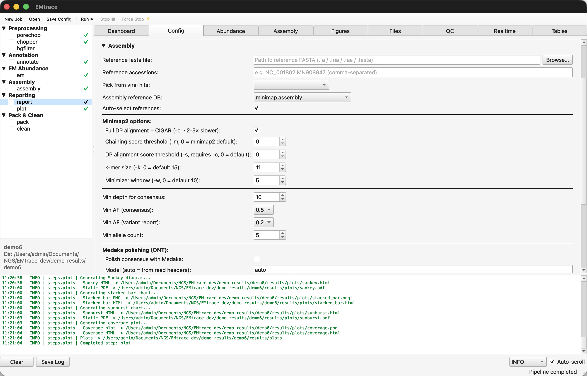
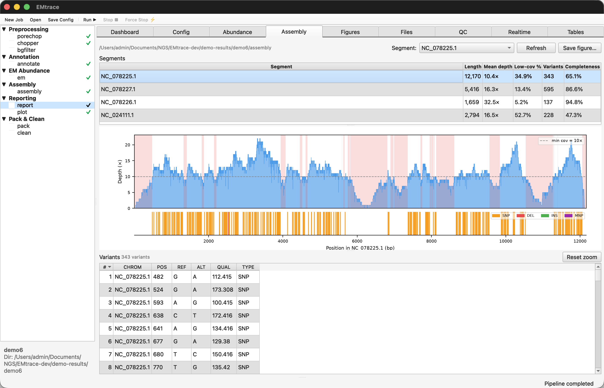
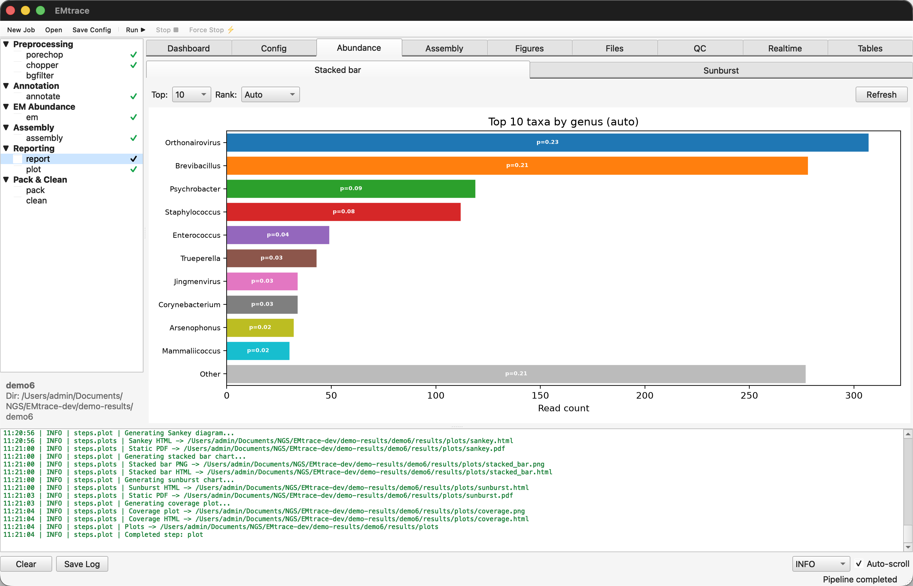

# EMtrace tutorial

*To read this offline, open `demo/DEMO.html` in a browser.*

<style>
table { border-collapse: collapse; }
th, td { border: 1px solid rgba(128, 128, 128, 0.45); padding: 3px 8px; }
thead th { border-bottom: 2px solid currentColor; vertical-align: bottom; }
</style>


A worked example on real sequencing data, small enough to run on a laptop. It covers the four
things EMtrace does:

1. **Virus detection** with EM abundance estimation
2. **Reference-based consensus assembly**
3. **Real-time monitoring** of a run in progress
4. **16S rRNA profiling** of a bacterial community

Demos 1–5 use the command line; [Demo 6](#demo-6-consensus-assembly-in-the-desktop-app) repeats
Demo 3 in the desktop app.

Run times below were measured on a 2023 MacBook Pro (Apple M2 Pro, 12 cores, 16 GB RAM) with
8 threads.


**Contents**

- [Before you start](#before-you-start)
- [Demo 1: Virus detection and EM abundance](#demo-1-virus-detection-and-em-abundance)
- [Demo 2: Divergent viruses with a protein search](#demo-2-divergent-viruses-with-a-protein-search)
- [Demo 3: Reference-based consensus assembly](#demo-3-reference-based-consensus-assembly)
- [Demo 4: Real-time monitoring](#demo-4-real-time-monitoring)
- [Demo 5: 16S profiling of a mock community](#demo-5-16s-profiling-of-a-mock-community)
- [Demo 6 (GUI): Consensus assembly in the desktop app](#demo-6-consensus-assembly-in-the-desktop-app)
- [Troubleshooting](#troubleshooting)
- [The demo data in detail](#the-data)

<a id="before-you-start"></a>
## Before you start

**The demo data.** `demo/reads/` holds two small public libraries ([details](#the-data)):

- 12,000 nanopore reads of a pool of *Rhipicephalus bursa* ticks carrying Crimean–Congo
  haemorrhagic fever virus (CCHFV) and Jingmen tick virus (JMTV), for the virus demos (1–4 and 6);
- 8,000 full-length 16S rRNA reads of the ZymoBIOMICS Gut Microbiome Standard, a mock community of
  known composition, for Demo 5.

**1. Start EMtrace in a terminal.** Installation is covered in the
[User Guide](../docs/UserGuide.v1.0.md#installing-emtrace). The commands below call `emtrace`.
Pick the route you installed by:

- **Installed from source** (`pip install -e ".[gui]"`): activate the environment EMtrace was
  installed into.

  ```bash
  cd /path/to/EMtrace
  source .venv/bin/activate
  emtrace --version
  ```

- **Installed macOS app** (`EMtrace.app` from the `.dmg`): the app's binary also runs the
  command-line interface. Point `emtrace` at it for this terminal session:

  ```bash
  alias emtrace=/Applications/EMtrace.app/Contents/MacOS/EMtrace
  emtrace --version
  ```

Each route should print the EMtrace version. The `alias` lasts only for the current terminal, so
repeat it in any new terminal where you run `emtrace`.

**2. Get the demo data.** The demos run from a demo folder that holds `demo/reads/`:

- **Installed from source:** the reads are already in the repository, in `demo/reads/`. The
  repository folder is your demo folder:

  ```bash
  cd /path/to/EMtrace
  ```

- **Installed macOS app:** the reads are not part of the app. Make a demo folder and download the
  `demo/` folder of the [EMtrace repository](https://github.com/weinstein-bioinfo/EMtrace/tree/main/demo)
  into it (about 14 MB: the reads, this page and its figures):

  ```bash
  mkdir -p ~/EMtrace-demo && cd ~/EMtrace-demo
  curl -L https://github.com/weinstein-bioinfo/EMtrace/archive/refs/heads/main.tar.gz \
    | tar xz --strip-components=1 EMtrace-main/demo
  ```

Run every command of the demos from this folder.

**3. Set the database directory** and install the three databases the demos use:

```bash
export EMTRACE_DB_DIR=/path/to/EMtrace-databases

emtrace databases --install minimap.refseq.abv.1g   # ~23 GB
emtrace databases --install diamond.uniref.vi       # ~1.6 GB
emtrace databases --install minimap.rrnDB.dedup     # ~0.4 GB, Demo 5 only
```

`minimap.refseq.abv.1g` is the RefSeq archaeal, bacterial and viral set reduced to one genome per
bacterial and archaeal genus, with all viral genomes kept. It is the database the User Guide
recommends for [vector samples](../docs/UserGuide.v1.0.md#virus-surveillance-studies) such as ticks.

`diamond.uniref.vi` (UniRef100 viral proteins) is the protein half of the `vi.chain2` strategy, used
in [Demo 2](#demo-2-divergent-viruses-with-a-protein-search).

`minimap.rrnDB.dedup` (rrnDB 5.10 16S rRNA genes, one representative per named species) is the 16S
reference of `--profile 16S`, used in [Demo 5](#demo-5-16s-profiling-of-a-mock-community). Skip it
if you run only the virus demos.

| | Download | On disk | Download time |
|:--|--:|--:|--:|
| `minimap.refseq.abv.1g` | ~16 GB | ~23 GB | 15 min |
| `diamond.uniref.vi` | ~0.5 GB | ~1.6 GB | 25 s |
| `minimap.rrnDB.dedup` | ~0.09 GB | ~0.4 GB | 5 s |
| **Total** | **~16 GB** | **~25 GB** | ~15-16 min|

<br>

**Disk space:** allow about 35 GB — 25 GB for the databases and a few GB for results.

> **No host filter.** The demo skips host and background filtering: the `--pipe` lists leave out
> the filter step (`flt`), and Demo 4 passes `--hostgen 0`. You therefore do not have to download a
> tick or human genome, and tick reads simply stay unannotated. For your own samples, keep `flt` in
> the step list and pass `--bgfilter` with the host genome (default: `Homo_sapiens`).

**4. Create the results folder** in the demo folder.
The demos write their results to `./demo-results`, and the joined input files of Demos 3, 5 and 6
and the watch folder of Demo 4 go there too:

```bash
mkdir -p demo-results
```

<a id="demo-1-virus-detection-and-em-abundance"></a>
## Demo 1: Virus detection and EM abundance

**What it shows:** the viruses the original study confirmed by PCR are identified from the first
4,000 reads of the library.

**Run** (one batch, no assembly). The reads in this library are short (mean at 345 bp), thus keep everything above 100 bp with `--minreadlength 100`:

```bash
emtrace run \
  --reads  demo/reads/ticks58-37_0.fastq.gz \
  --sample demo1 \
  --res    ./demo-results \
  --pipe   pore,chop,ann,em,rep \
  --anns   abv.1g \
  --minreadlength 100 \
  --numth  8 \
  -v
```

**Expected run time:** `~2 min`.

**Expected output.** Under `demo-results/demo1/`:

| Path | Contents |
|:--|:--|
| `reads/` | Preprocessed reads, partitioned into viral, phage, bacterial and unannotated bins |
| `annotation/annot1.tsv` | One row per read: subject accession, taxon, score |
| `results/reports/abund_table.tsv` | Per-taxon EM abundance and read counts |
| `results/reports/stats_report.html` | Interactive report (open in a browser) |
| `results/plots/` | Sankey, sunburst and stacked-bar figures, QC histograms |

<br>

In `abund_table.tsv`, look for **Orthonairovirus** (CCHFV) and
**Jingmenvirus** (JMTV). A taxon counts as detected here once it has at least 10 reads, the
threshold used throughout this demo, so that a handful of spurious alignments to a large database is
not reported as a finding:

**Table 1 |** Viruses detected in the first 4,000 reads (`abv.1g`).

| Taxon | Reads (`readn_em`) | EM probability (`prob`) |
|:--|--:|--:|
| Orthonairovirus (CCHFV) | 90 | 0.180 |
| Jingmenvirus (JMTV) | 12 | 0.024 |

<br>

Most reads in the file are tick host sequence and stay unannotated
(`stats_report.html`), which is expected for a field library analysed without
a host filter.

**The point of the demo:** both viruses that Ergünay et al. confirmed by PCR in this pool are
recovered from 4,000 reads — roughly what a MinION writes in its first few minutes.

Note how differently the two sit above the threshold. CCHFV is comfortable at 90 reads, but JMTV
clears it with 12 — a fragile detection, close enough to the line that a smaller batch or a sample
with less virus would miss it. A count that marginal is where a more sensitive search earns its
place ([Demo 2](#demo-2-divergent-viruses-with-a-protein-search)).

<a id="demo-2-divergent-viruses-with-a-protein-search"></a>
## Demo 2: Divergent viruses with a protein search

**What it shows:** chaining a protein search after the nucleotide search recovers viruses too
divergent for nucleotide alignment, using the `vi.chain2` strategy.

**Run** on the same batch, sending the reads minimap2 leaves unassigned to DIAMOND:

```bash
emtrace run \
  --reads  demo/reads/ticks58-37_0.fastq.gz \
  --sample demo2 \
  --res    ./demo-results \
  --pipe   pore,chop,ann,em,rep \
  --anns   vi.chain2 \
  --minreadlength 100 \
  --numth  8 \
  -v
```

**Expected run time:** `2-3 min`.

**Expected output.** As Demo 1, plus a second hit table, `annotation/annot1.diamond.uniref.vi.tsv`,
holding the protein hits. Compare `demo2/results/reports/abund_table.tsv` with Demo 1's:

**Table 2 |** Viral reads with the nucleotide search alone (Demo 1) and with the protein search
added (Demo 2, `vi.chain2`).

| Taxon | Demo 1 (`abv.1g`) | Demo 2 (`vi.chain2`) | Change |
|:--|--:|--:|--:|
| Jingmenvirus (JMTV) | 12 | 276 | 23× |
| Orthonairovirus (CCHFV) | 90 | 134 | 1.5× |
| Mivirus (Bole tick virus 3) | — | 33 | detected |
| Phlebovirus | — | 1 | below threshold |

<br>

Reads are `readn_em`, the EM-adjusted count. CCHFV appears as two species rows in Demo 2
(*Orthonairovirus parahaemorrhagiae* and *O. haemorrhagiae*); the genus total is given here.

JMTV gains most, from a marginal detection to an unambiguous one, and *Mivirus* appears only here.
CCHFV gains least: it has closer RefSeq relatives for the nucleotide search to find.

> **Caution.** The protein search uses a permissive DIAMOND bitscore threshold (≥ 80) because
> nanopore errors break reads into short ORFs. Treat a species supported only by protein hits as
> tentative and confirm it with a nucleotide hit, an assembly or a second method.

<a id="demo-3-reference-based-consensus-assembly"></a>
## Demo 3: Reference-based consensus assembly

**What it shows:** EMtrace picks reference genomes automatically from the annotation hits, including
one per segment of a segmented virus, and builds consensus sequences.

**Run** on all three batches together. The step list adds `ass` (assembly), which the `main`
workflow does not include:

```bash
cat demo/reads/ticks58-37_*.fastq.gz > demo-results/ticks58-37_12k.fastq.gz

emtrace run \
  --reads  demo-results/ticks58-37_12k.fastq.gz \
  --sample demo3 \
  --res    ./demo-results \
  --pipe   pore,chop,ann,em,ass,rep,plot \
  --anns   abv.1g \
  --ref_auto \
  --no-medaka \
  --minreadlength 100 \
  --numth  8 \
  -v
```

`--no-medaka` keeps the demo short and dependency-free. Medaka polishing is on by default and needs
a basecaller-matched model, which this SRA deposit does not carry in its read headers.

**Expected run time:** ` ~2 min`.

**Expected output.** `demo3/assembly/` holds the consensus sequences (`consensus.fa`), the
alignment (`reads.refgen.md.bam`), the variants (`vcf.gz`) and the selection log
(`ref_selection.tsv`). Automatic selection ran per segment and chose four references:

**Table 3 |** References chosen automatically: reads, mean depth, positions with at least one read
(as in `coverage.html`) and consensus coverage (positions with at least 10 reads).

| Virus | Segment | Reference | Length (bp) | Reads | Mean depth | ≥ 1 read | Coverage |
|:--|:--|:--|--:|--:|--:|--:|--:|
| CCHFV | L | NC_078225.1 | 12,170 | 261 | 10.4× | 99.2% | 65.1% |
| CCHFV | M | NC_078227.1 | 5,416 | 193 | 16.3× | 97.9% | 86.6% |
| CCHFV | S | NC_078226.1 | 1,659 | 104 | 32.5× | 99.1% | 94.8% |
| JMTV | 4 | NC_024111.1 | 2,794 | 178 | 16.5× | 87.4% | 47.3% |

<br>

Coverage is the fraction of the reference called as non-N bases; positions below the 10× depth
threshold are masked. Overall, 736 reads mapped at a mean depth of 14.3×
(`results/reports/stats_assembly.csv`).

**Open `results/plots/coverage.html` in a browser.** 
One panel per selected reference plots read depth along the genome; hover for the depth at a
position, and drag to zoom into a region. The reads spread along the whole of every CCHFV segment
instead of piling up in one place, which is what a genuine virus looks like: a spurious hit (a
conserved motif, a contaminant, a low-complexity stretch) shows as a single spike. Static copies are
in `coverage.png` and `coverage.pdf`.

The plot's panel titles count every position with at least one read (the ≥ 1 read column of
Table 3), so their percentages are higher than the consensus coverage, which counts only positions
with at least 10 reads. The two
together show where more sequencing would fill the consensus: the reads already reach almost the
whole CCHFV genome, and the dips below 10× in the L segment are what remains masked.

**Read `ref_selection.tsv`** — it explains each decision. Two things are visible there:

- **The selected CCHFV references are strain AP92**, the Aigai (genogroup VI) lineage. Selection
  found the right divergent lineage on its own, from the reads, with no reference given.
- **Only one JMTV segment was assembled.** Candidates for the other three were found but rejected
  with "reads already covered by a chosen accession": the greedy read cover takes the reference that
  best explains the reads not yet covered, and at this depth JMTV's remaining segments had too few
  reads of their own. A fifth candidate was dropped as "species below min_reads=10".

**What to look for:** coverage tracks depth, not virus. CCHFV's three segments fall from 94.8% to
65.1% as they get longer and shallower, and the one JMTV segment, with the fewest reads to spread
over 2.8 kb, reaches 47.3%. Partial coverage from 12,000 reads is expected, not a failure. Demo 4
shows the same effect as a progression, batch by batch.

<a id="demo-4-real-time-monitoring"></a>
## Demo 4: Real-time monitoring

**What it shows:** EMtrace watches a directory and analyses each batch of reads as it arrives, the
way it would during a MinKNOW run.

**1. Start the monitor** on an empty directory:

```bash
mkdir -p demo-results/minknow-sim

emtrace watch \
  --dir    demo-results/minknow-sim \
  --sample demo4 \
  --res    ./demo-results \
  --anns   abv.1g \
  --hostgen 0 \
  --report \
  --minreadlength 100 \
  --numth  8 \
  -v
```

It waits, printing nothing until a file appears.

**2. In a second terminal, feed it the batches**, imitating a sequencer writing files:

```bash
cd /path/to/EMtrace    # the demo folder
for f in demo/reads/ticks58-37_*.fastq.gz; do
  cp "$f" demo-results/minknow-sim/
  sleep 120
done
```

The 120-second gap gives each batch time to finish before the next arrives — a batch of 4,000 reads
takes about 90 s here, so the monitor is idle and waiting when each new file lands. On a real run
MinKNOW writes a file every few minutes.

**3. Watch the console.** After each batch EMtrace prints the top taxa by EM abundance. Expect
Orthonairovirus from the first batch, with the ranking changing from 2nd to the 1st in the top taxa list.

**4. Stop with Ctrl+C.** EMtrace finishes the current batch, merges all batches into the job's
standard folders and writes the final report.

**Expected run time:** 85–96 s per batch (median 90 s), and 53 s for the merge and report on
Ctrl+C. Each batch is processed well inside the 120 s between files, thus keeping pase with a typical MinKNOW sequencer.

**Expected output.** Under `demo-results/demo4/`:

| Path | Contents |
|:--|:--|
| `watch/batches/batch_000N/` | One directory per batch, with its reads, annotation and `batch.json` (batch number, read count, source file) |
| `watch/realtime_annot.tsv` | Cumulative hit table, one row per read and subject, growing with each batch |
| `watch/results/abund_table.tsv` | The live abundance table, updated after every batch |
| `reads/`, `annotation/`, `results/` | The merged job, written on Ctrl+C |

<br>

The merged result matches a single run over the same 12,000 reads (Demo 3):

**Table 4 |** Merged watch-mode result against a single run over the same 12,000 reads.

| Taxon | Watch mode (Demo 4) | Single run (Demo 3) |
|:--|--:|--:|
| Orthonairovirus (CCHFV) | 308 | 307 |
| Jingmenvirus (JMTV) | 35 | 34 |

<br>

Processing the library batch by batch therefore costs nothing in accuracy. EM is recomputed from
scratch at the merge, so a difference of a read or two from the live table is normal.

> **No sequencing clock.** SRA removed the per-read start times from this deposit, so EMtrace
> reports batches by read count only, with no sequencing time or throughput ratio. On a live
> MinKNOW run, where reads carry `start_time`, it also reports how far ahead of the sequencer it is
> running.

<a id="demo-5-16s-profiling-of-a-mock-community"></a>
## Demo 5: 16S profiling of a mock community

**What it shows:** EMtrace profiles a full-length 16S amplicon library at species level with the
bundled 16S settings, and the profile can be checked against the known composition of a mock
community.

**Run** on both files together, with the 16S profile:

```bash
cat demo/reads/gutmock_r1_*.fastq.gz > demo-results/gutmock_r1_8k.fastq.gz

emtrace run \
  --reads   demo-results/gutmock_r1_8k.fastq.gz \
  --sample  demo5 \
  --res     ./demo-results \
  --profile 16S \
  --pipe    pore,chop,ann,em,rep \
  --numth   8 \
  -v
```

`--profile 16S` switches to the 16S profiling: the
`16S.rrnDB.dedup` annotation strategy, reads kept between 1,200 and 1,800 bp at mean quality ≥ 10,
reads split at internal adapters (chimeric amplicons), 25 secondary alignments per read for the EM
to weigh, a softer EM (temperature 10), and a 1% tail trim: the smallest taxa that together hold
at most 1% of the reads are dropped from the reports. This removes the long tail of single-read
neighbours that full-length 16S produces against a 16S database. No
host filtering for 16S data, so `flt` is left out of the step list.

**Expected run time:** `~6 min`.

**Expected output.** Under `demo-results/demo5/`, the same layout as
[Demo 1](#demo-1-virus-detection-and-em-abundance). `results/reports/abund_table.tsv` gives the
species and genus of every taxon with its EM probability (`prob`) and EM-adjusted read count
(`readn_em`). `results/EM.taxid_prob.tsv` holds the EM estimate for every taxon, before the tail
trim.

Of the 8,000 reads, 6,874 (86%) pass the 1,200–1,800 bp, Q ≥ 10 filter, and every one of them is
assigned to a bacterial 16S sequence (`results/reports/stats_report.html`).

Compare the genera with the certificate's 16S-only composition, the truth used in the
[EMtrace manuscript](#citing-emtrace):

**Table 5 |** Genus composition of the Gut Microbiome Standard: certificate (16S-only) against
EMtrace.

| Genus | Expected (16S-only, %) | EMtrace (%) | Reads (`readn_em`) |
|:--|--:|--:|--:|
| *Faecalibacterium* | 17.6 | 19.0 | 1,304 |
| *Veillonella* | 15.9 | 27.1 | 1,863 |
| *Escherichia* | 12.1 | 11.1 | 760 |
| *Bacteroides* | 9.9 | 20.4 | 1,403 |
| *Roseburia* | 9.9 | 2.5 | 170 |
| *Limosilactobacillus* | 9.6 | 1.2 | 81 |
| *Bifidobacterium* | 8.8 | 2.4 | 163 |
| *Fusobacterium* | 7.5 | 2.1 | 143 |
| *Prevotella* | 5.0 | 8.0 | 549 |
| *Clostridioides* | 2.6 | 5.4 | 372 |
| *Akkermansia* | 0.97 | 0.9\* | 64\* |
| *Methanobrevibacter* (archaeon) | 0.07 | 0 | 0 |
| Other (taxa outside the standard) | 0 | 0.01 | 1 |

<br>

\* In the EM estimate (`results/EM.taxid_prob.tsv`), but dropped from the reports by the 1% tail trim.

Every reported genus is represented by the right species: *Veillonella rogosae*, *Bacteroides
fragilis*, *Faecalibacterium prausnitzii*, *Escherichia coli*, *Prevotella corporis*,
*Clostridioides difficile*, *Roseburia hominis*, *Bifidobacterium adolescentis*, *Fusobacterium
nucleatum* and *Limosilactobacillus fermentum*, as on the certificate.

Four trace members (*Salmonella*, *Enterococcus*, *Clostridium* and the archaeon *Methanobrevibacter*; ≤ 0.07% each), below the 10-read threshold.

**What to look for:**

- **The taxon list.** The report lists 10 of the 11 bacterial genera expected above the threshold,
  each with the correct species, and no genus or species outside the standard. The eleventh,
  *Akkermansia* (64 reads, 0.9%), is in the EM estimate but falls to the 1% tail trim, together
  with three single reads (67 reads, 0.97% of the library). The only taxon outside the standard is a single read on *Mycetocola zhujimingii*, far below the
  threshold. On the full replicates the manuscript found no false-positive genus at any batch.
- **The proportions.** Genus L1 (sum of absolute differences from the truth, 0–2) is 0.58, as on
  the full replicates. Most of it comes from the data: every tool in the manuscript over-called
  *Bacteroides* and *Veillonella* and under-called *Roseburia*, *Bifidobacterium* and
  *Limosilactobacillus*.
- **How early the answer settles.** The 8,000 reads are the first 17 min of a run of about 2 h. In
  the manuscript the first 4,000-read batch was within 0.012 of the final genus L1, so a few minutes
  of sequencing and analysis already give a close estimate of the whole run's profile.

To score it yourself, the truth table and the synonym map used in the manuscript are
`data/truth/gutmock_16S_truth.tsv` and `gutmock_16S_collapse.tsv` in
[EMtrace-benchmark](https://github.com/weinstein-bioinfo/EMtrace-benchmark).

<a id="demo-6-consensus-assembly-in-the-desktop-app"></a>
## Demo 6: Consensus assembly in the desktop app

**What it shows:** the analysis of [Demo 3](#demo-3-reference-based-consensus-assembly) run from the
EMtrace desktop app instead of the command line, with the coverage of each assembled genome
inspected in the app's Assembly view.

**1. Prepare the input.** The app takes one FASTQ file per job, so join the three batches as in
Demo 3 (skip this if you ran Demo 3; the file is already there):

```bash
cat demo/reads/ticks58-37_*.fastq.gz > demo-results/ticks58-37_12k.fastq.gz
```

**2. Start the app.**

- **Installed macOS app:** double-click **EMtrace** in *Applications*. The first start shows a
  security warning; see [Opening the app](../docs/UserGuide.v1.0.md#opening-the-app).
- **Installed from source:** activate the environment as in [Before you start](#before-you-start)
  and run `emtrace gui`.

The window has three panels: the step list (left), the content area with its tabs (centre) and the
live log (bottom).

**3. Create the job.** Choose **File › New Job…** (or **New Job** on the toolbar) and fill in:

| Field | Value |
|:--|:--|
| Job name | `demo6` |
| Input reads | `ticks58-37_12k.fastq.gz` in the `demo-results` folder (**Browse…**) |
| Reads R2 (paired-end) | leave empty |
| Output base directory | the `demo-results` folder used by the other demos |

<br>

**4. Set the configuration** on the **Config** tab (**View › Config**). Keep *Profile* at *default
(virome)* and change these settings, the GUI equivalents of Demo 3's options:

| Section | Setting | Value | Demo 3 option |
|:--|:--|:--|:--|
| Runtime | Threads | 8 | `--numth 8` |
| Preprocessing › Chopper | Min length (bp) | 100 | `--minreadlength 100` |
| Annotation | Annotation preset | `abv.1g` | `--anns abv.1g` |
| Assembly | Auto-select references | on | `--ref_auto` |
| Assembly › Medaka polishing (ONT) | Polish consensus with Medaka | off | `--no-medaka` |

<br>

Click **Apply Changes**, then **File › Save Config…** to keep the settings with the job
(`demo-results/demo6/config.yaml`).

**5. Choose the steps.** In the step list, tick **porechop**, **chopper**, **annotate**, **em**,
**assembly**, **report** and **plot**. Leave **bgfilter** (host filtering) and the *Pack & Clean*
steps unticked. This is Demo 3's `--pipe pore,chop,ann,em,ass,rep,plot`.

**6. Run.** Click **Run ▶** on the toolbar (or **Run › Run Pipeline**). Each step shows ● while it
runs and ✓ when it finishes, and the log panel follows the run.

**Expected run time:** `~2 min`

<br>
**Figure 1 | Config tab after the run.** Step list (left): the seven ticked steps finished (✓); bgfilter and
Pack & Clean were left out. Assembly section: Auto-select references on, Medaka polishing off.
Log panel (bottom): the plot step writing `coverage.png` and `coverage.html`.

**7. Inspect the results.** The output in `demo-results/demo6/` is the same as Demo 3's, with the
same four references and the same read counts. The app shows it in its tabs:

- **Assembly** (**View › Assembly**): the coverage strip for the segment chosen under *Segment:*,
  with read depth along the reference, positions below the 10× consensus threshold shaded red,
  the threshold line and the variant positions in a track below. The *Segments* table summarises
  every reference (length, mean depth, low-coverage share, variants, completeness); click a row to
  switch segment, or click a variant in the variant table to jump to it.
- **Figures** (**View › Figures**): the generated plots. `coverage.png` shows in the app; selecting
  `coverage.html`, the interactive depth plot of
  [Demo 3](#demo-3-reference-based-consensus-assembly), opens it in your web browser (the macOS app
  leaves out the in-app HTML viewer to save space).
- **Abundance** and **Tables**: the EM abundance (stacked bar and sunburst) and the abundance and
  annotation tables of Demo 1, for all 12,000 reads.

<br>
**Figure 2 | Assembly tab, CCHFV L segment (NC_078225.1).** The Segments table lists the four selected
references; its Completeness column is the consensus coverage of Table 3. Below it: read depth along the
12 kb segment with the 10× threshold (dashed), the variant positions and the variant table. At
10.4× mean depth the reads reach almost every position, but a third of the segment stays below 10×
and is masked (red), leaving 65.1% called.

<br>
**Figure 3 | Abundance tab.** The ten most abundant genera by EM read count (*Rank: Auto*), with the EM
probability on each bar. *Orthonairovirus* (CCHFV) ranks first over all 12,000 reads (p = 0.23)
and *Jingmenvirus* (JMTV) seventh; *Other* sums the remaining genera.

**What to look for:** step through the four segments in the Assembly tab. Each CCHFV segment is
covered from end to end, and the red-shaded stretches show which parts of the consensus are masked
below 10×.

<a id="troubleshooting"></a>
## Troubleshooting

| Problem | Likely cause and fix |
|:--|:--|
| `database not found` | `EMTRACE_DB_DIR` is unset or points elsewhere. Check `emtrace databases --list`. |
| A required tool is missing at startup | Install the external tools from Bioconda; see the [User Guide](../docs/UserGuide.v1.0.md#installing-dependencies). |
| Fewer viral reads than expected, or a virus missing | These viruses are divergent. If a single batch gives too few reads, run all three (`Demo 3`) or try `--anns vi.chain2`, whose protein search is less sensitive to sequence distance. |
| Assembly produces no consensus | `--ref_auto` needs at least 10 reads on a reference. Check that annotation found the viruses first. |
| Medaka warnings | Medaka is optional and skipped with a warning if absent. The demo passes `--no-medaka`. |
| Watch mode ignores files already in the directory | By design. Pass `--scan-existing`, or copy the files in after the monitor starts. |
| Demo 5 keeps far fewer than 8,000 reads | `--profile 16S` keeps reads of 1,200–1,800 bp at mean quality ≥ 10. Check that the profile is set; without it the virus defaults apply. |

<br>

<a id="the-data"></a>
## The demo data in detail

`demo/reads/` holds two libraries: a tick field library for the virus demos (1–4 and 6) and a 16S mock
community for [Demo 5](#demo-5-16s-profiling-of-a-mock-community).

<a id="tick-pool-58-37-demos-1-4"></a>
### Tick pool 58-37 (Demos 1–4 and 6)

`demo/reads/` holds 12,000 nanopore reads (3.8 MB) from **tick pool 58-37**, a field library of
301 pooled *Rhipicephalus bursa* ticks collected in Turkey, published by Ergünay et al. 2023
(*Front. Microbiol.* 14:1177651; BioProject PRJNA878809, run SRR21504617). These are the first
12,000 reads of the public deposit, split into three files of 4,000:

| File | Reads |
|:--|--:|
| `ticks58-37_0.fastq.gz` | 4,000 |
| `ticks58-37_1.fastq.gz` | 4,000 |
| `ticks58-37_2.fastq.gz` | 4,000 |

<br>

The pool contains two viruses confirmed by PCR in the original study:

- **Crimean–Congo haemorrhagic fever virus** (CCHFV, genus *Orthonairovirus*), a segmented
  bunyavirus with L, M and S segments. These sequences belong to the divergent Aigai virus
  (genogroup VI, AP92-like) lineage.
- **Jingmen tick virus** (JMTV, genus *Jingmenvirus*), a segmented flavi-like virus with four
  segments.

The original study also reported two further viruses from sequence data alone, *Mivirus* (Bole tick
virus 3) and *Phlebovirus* (brown dog tick phlebovirus 2); both turn up in
[Demo 2](#demo-2-divergent-viruses-with-a-protein-search), once a protein search is added.

> **Note.** The reads come from SRA already adapter-trimmed and quality-filtered by the original
> authors, and SRA removed the per-read start times. EMtrace's own preprocessing is therefore close
> to a no-op on this library, and watch mode reports no sequencing clock
> ([Demo 4](#demo-4-real-time-monitoring)).

<a id="why-minreadlength"></a>
**Why Demos 1–4 pass `--minreadlength 100`.** This is a short-read library: the mean read is
345 bp, and 76% of the reads are between 100 and 399 bp. EMtrace's default minimum of 400 bp is
tuned for raw MinKNOW output, where reads that short are mostly adapter and fragments, and it would
discard three quarters of this library before annotation. The original authors had already filtered
the deposit at 100 bp, so the demo matches that threshold and the reads enter the pipeline as
deposited — the same setting used for this library in the [EMtrace manuscript](#citing-emtrace).

<a id="gut-microbiome-standard-demo-5"></a>
### ZymoBIOMICS Gut Microbiome Standard (Demo 5)

8,000 full-length 16S rRNA amplicon reads (8.9 MB; mean read 1.5 kb) of the **ZymoBIOMICS Gut
Microbiome Standard** (D6331), from Oxford Nanopore's open dataset `zymo_16s_2025.09`: replicate 1
(flow cell FBB38036, barcode 07), SQK-MAB114.24, R10.4.1, basecalled by ONT with Dorado 1.1.1 (SUP
model v5.2.0). They are the first 8,000 reads of the replicate by read start time — the first 17 min
of sequencing — split into two files of 4,000:

| File | Reads | Sequencing time |
|:--|--:|:--|
| `gutmock_r1_0.fastq.gz` | 4,000 | 0–9.4 min |
| `gutmock_r1_1.fastq.gz` | 4,000 | 9.4–16.8 min |

<br>

The standard is a defined mix of 14 bacterial species (five *Escherichia coli* strains among them),
one archaeon and two yeasts. Its certificate gives the expected composition, so the result can be
scored against a known answer. ONT publishes one basecalled BAM per replicate rather than MinKNOW's
batch files, so the 4,000-read files were cut here from the reads sorted by start time, as in the
[EMtrace manuscript](#citing-emtrace).

Check the read lengths of your own libraries before lowering the default. `emtrace run` warns when
many reads fall below the minimum.

## Reproducing the manuscript

This demo is a small illustration, not the benchmark. To reproduce the figures and tables of the
[EMtrace manuscript](#citing-emtrace), use [EMtrace-benchmark](https://github.com/weinstein-bioinfo/EMtrace-benchmark)
with EMtrace v1.0.0. The replays of both libraries are framework C
(`jobs/framework_C/framework_C.replay.bash`; the gut standard as `gutmock_sup_r1`–`r4`), and their
score tables are in `metrics/framework_C/`.

<a id="citing-emtrace"></a>
## Citing EMtrace

Weinstein I, Smura T, Leppanen O, Krupińska M, Vauhkonen H, Sironen T, Grzybek M, Vapalahti O,
Kant R. EMtrace: offline nanopore metagenomics on a laptop for rapid viral diagnostics, genome
recovery and 16S profiling. *bioRxiv* (2026). <https://doi.org/10.64898/2026.11.09.765303>

## Citing the data

Ergünay, K. et al. Metagenomic nanopore sequencing of tick-borne pathogens and the virome of
*Rhipicephalus bursa* ticks. *Front. Microbiol.* **14**, 1177651 (2023).
BioProject PRJNA878809, run SRR21504617.

Oxford Nanopore Technologies. ZymoBIOMICS Microbial Communities with 16S amplicon (dataset
zymo_16s_2025.09). https://epi2me.nanoporetech.com/zymo_16s_2025.09/ (2025).
`s3://ont-open-data/zymo_16s_2025.09`, GutMock replicate 1 (FBB38036, barcode 07).
